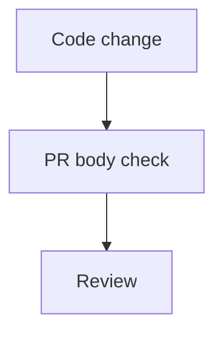

## TL;DR

<!-- One or two sentences on what changed and why. -->

## How it works

<!-- Keep a mermaid diagram. Replace this flow if the change needs a different one. -->

## Summary

<!-- Short bullets for the behavior change. -->

-

## Files changed

| File | Change |
| --- | --- |
| `path` | What changed |

## How to test

<!-- Commands or clicks a reviewer can repeat. -->

-

## Review

<!-- Risks, follow-ups, and anything the reviewer should look at closely. -->
