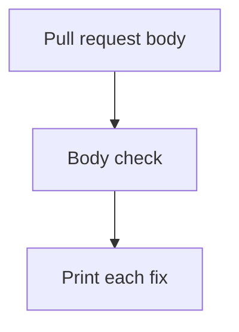

## TL;DR

Add a pull request template and a report-only body check.

## How it works

## Summary

- The template lists the six required sections.
- The check prints problems and exits 0 while report-only.

## Files changed

| File | Change |
| --- | --- |
| `.github/pull_request_template.md` | Add the section template |
| `scripts/check_pr_body.py` | Check headings, mermaid, and banned footer text |

## How to test

- `uv run python scripts/check_pr_body.py tests/fixtures/pr_bodies/missing_sections.md`
- `uv run pytest -q tests/test_pr_body.py`

## Review

Confirm `REPORT_ONLY` stays true in `scripts/check_pr_body.py`.
